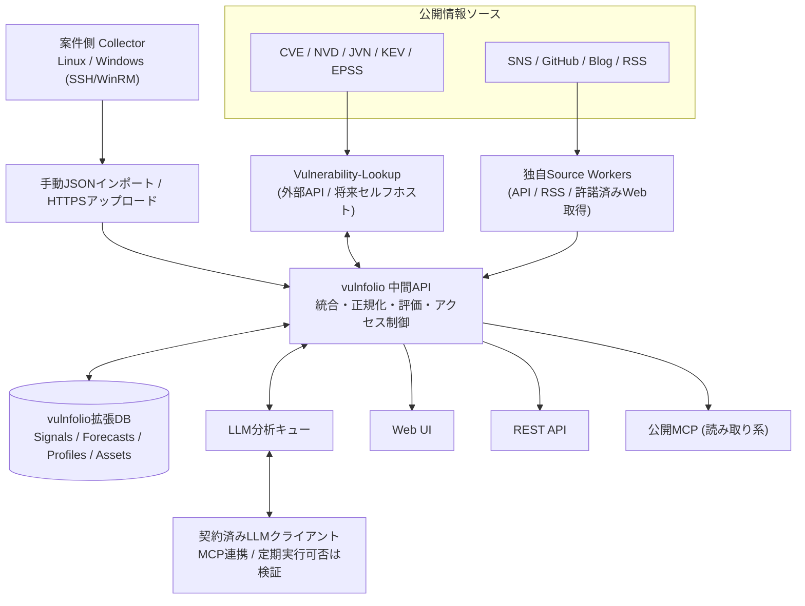

# アーキテクチャ案

- 更新日: 2026-11-19
- 状態: **第一候補・未確定**。PoCを通じて採否を決定する。
- 目的: 既存OSSをできる限り無改造で利用し、vulnfolio独自の機能を外付けする。

## 全体を横断する設計原則（2026-11-19合意）

**収集だけでなく、脆弱性データソース・SNS・正規化・照合・スコア・LLM・公開まで、外部実装に依存する箇所を可能な限りモジュール化**する。Ansible/Vuls/OpenVASは共通のジョブAPIと正規化モデルを通して扱い、特有のデータ形式・運用差はAdapterが吸収する。ただし検査能力の違いはCapabilityとして公開し、実際には得られていないFindingを作らない。

モジュール化のためにすべてを別プロセス化しない。**モジュラーモノリス＋必要な収集ワーカー**を初期のデプロイ方針とし、個人運用の単純さを優先する。Web/REST/MCPは同じコアサービスを使う。詳しいブロック図、共通API、観測データとFindingの分離は[モジュール化設計](modularity.md)を参照。

## 1. 主要方針

1. **既存OSSは脆弱性情報のSystem of Record候補**。Vulnerability-LookupのAPI/Feeder/Sightings/VulnMCPをまず評価する。
2. **独自中間レイヤー（Facade/BFF）**はUIへの集約APIと独自機能を提供する。上流データの直接変更や上流内部DBへの直接依存を避ける。
3. **独自拡張DB**はCVEの複製全件ではなく、独自の観測・分析・予測・案件データを基本的に保持する。必要時のみ検索キャッシュ/インデックスを追加。
4. **外部APIとセルフホストを差し替えられる上流アダプター**を用意する。上流のAPI制限・障害時にはステータス表示/キャッシュ利用で縮退する。
5. **公開情報と案件固有の情報は論理的に分離**。外部公開のWeb/API/MCPで内部資産・内部案件を既定で返さない。
6. LLMを呼ばなくても収集、正規化、数値評価、一覧表示は動作させる。

## 2. 論理構成

※ 資産情報が公共側へ流出しないアクセス制御が必要。図の矢印は概念的データフローであり、ネットワーク開放を意味しない。

## 3. 具体的なコンポーネント候補

| コンポーネント | 候補 | 状態 |
| --- | --- | --- |
| 公式脆弱性データ | Vulnerability-Lookup 公式公開API → 必要時セルフホスト | 第一候補 |
| 中間API | Python + FastAPI等 | 案、未決定 |
| 独自DB | PostgreSQL（正規化データ・時系列・案件情報） | 案、未決定 |
| ジョブ実行 | cron/systemd timers等 → 必要に応じてジョブキュー | 案 |
| Web UI | Tabler等のBootstrapベース管理画面キット | 候補 |
| SNS収集 | API/RSS優先、必要時Playwrightの独立ワーカー | 方針 |
| MCP | VulnMCP再利用を検証、vulnfolio固有ツールは追加アダプター | 方針 |
| LLM | 契約済みChatGPT/Claude等の正規クライアントでMCPを利用できるか検証 | 未検証 |

「MCPを作ればサブスクリプションを自動推論APIにできる」という前提は**置かない**。利用可能なクライアント・スケジュール・書込み権限・利用条件を個別検証する。

## 4. 上流アダプターのインターフェース案

上流バックエンドの内部DBを直接読むのではなく、境界を以下の機能で表現する。

- `search_vulnerabilities(query, filters, cursor)`
- `get_vulnerability(id)`
- `get_related_records(id)`
- `get_sightings(id)`
- `get_epss(id)`、`get_kev_status(id)` （可能なら一括取得）
- `get_changes(since, cursor)` （差分・更新取得、API能力次第）
- `get_source_health()` （取得時刻、失敗、失効を含む）

上流APIのパラメータ・レスポンス差異をこの境界で吸収する。公開APIとセルフホスト実装を併存させる場合は、同じ内部表現に正規化する。

**検証すること:** 上流のAPI認証/レート制限/再利用許諾、差分APIの安定性、検索に必要な絞込項目、Sightings書込権限、データ鮮度、欠損対応。

## 5. 拡張DBの概念モデル（案）

| エンティティ | 役割 |
| --- | --- |
| `VulnerabilityReference` | 上流ID・別名・参照先。全レコードの複製とは限らない |
| `ThreatEvent` | CVE未採番の脅威/噂を含む独立事象。後からCVEと関連付け可能 |
| `Evidence` | 投稿・記事・アドバイザリのURL/出典/公開時刻/観測時刻/取得権限 |
| `Observation` | 言及数、増加率、独立発信者数、PoC出現等の時系列値 |
| `AnalysisRun` | LLM解析の実行時刻・入力データ版・モデル/プロンプト版・結果と失敗 |
| `Forecast` | 対象事象、24h/7d/30d予測、根拠、不確実性、検証結果 |
| `Profile` | 案件/環境の単位（非公開） |
| `Asset` | サーバー/機器の識別（非公開） |
| `InstalledProduct` | 資産上のOS/ソフト/KB/バージョン（非公開） |
| `VulnerabilityMatch` | 資産と脆弱性候補の照合結果・根拠・照合時刻 |
| `Assessment` | 影響有無・調査中・対処済み等の手動評価と変更履歴 |
| `CollectionBatch` | 収集実行ID、入力方式、件数、エラー、最終成功時刻 |

### 区別すべき状態軸

- **事実確認:** `unconfirmed / under_review / confirmed / refuted`
- **世間の注目:** 注目度の数値・急増フラグ・収集カバレッジ
- **悪用:** KEV、公開PoC、外部の攻撃観測を各々の根拠付きで記録
- **資産との照合:** `possible / uncertain / not_affected / affected` 等
- **案件での対応:** `new / investigating / in_progress / mitigated / resolved / accepted_risk` 等

これらを単一の `severity` や一つの万能スコアへ潰さない。ステータス定数や具体的な変更遷移は実装前に確定する。

## 6. 収集・分析パイプライン

1. 各収集ジョブが元ソースと取得時刻・ソースIDを持つデータを作成
2. フォーマット検査、重複排除、識別子正規化、正確度の標識付け
3. 数値的なイベント評価（CVE出現/EPSS増加/KEV追加/投稿急増など）
4. 独自事象やCVEへの候補関連付け。確度不明は暫定状態
5. 高優先度・未解析・情報変化のある事象を分析キューに積む
6. LLMによる日次分析（追加分析は即時起動可能なら実行、無理なら保留）
7. 予測結果と出典の記録。UI/REST/MCPは保存済み結果を参照

**幂等性:** 同一収集バッチの再投入を重複反映しない。**追跡可能性:** SNSの削除・訂正や収集停止で既存の事実確認状態を安易に変えない。**縮退:** LLMなしでも検索/案件照合/既存予測表示は継続する。

## 7. APIと公開境界

### Web/UI向け統合API（例）

- `GET /api/v1/dashboard/global`
- `GET /api/v1/dashboard/my-environment` (非公開)
- `GET /api/v1/vulnerabilities`
- `GET /api/v1/vulnerabilities/{id}`
- `GET /api/v1/threat-events`
- `GET /api/v1/profiles` (非公開)
- `POST /api/v1/imports` (認証必須)
- `PATCH /api/v1/assessments/{id}` (認証必須)

これらは**契約案であり実装済みのAPIではない**。レスポンス形式とOpenAPI定義はPoC後に確定する。

### MCPツール案

公開系: `search_vulnerabilities`、`get_trending_vulnerabilities`、`get_emerging_threats`、`get_vulnerability_details`、`get_threat_timeline`。

内部分析系: `get_pending_analyses`、`submit_analysis_result`、`mark_analysis_failed`（認証・権限分離、入力検証、再実行の冪等性を必須とする）。

VulnMCPとの機能重複はまず調査し、安易に同名ツールを再実装しない。

## 8. 収集元・案件データの安全性

- エージェントレス収集は読み取り専用・最小権限。鍵や資格情報を成果物へ含めない。
- データは踏み台で出力し、閉域網は手動JSON取込。送信可能ならHTTPSで取り込む。
- アップロード時のスキーマ検査、件数/サイズ制限、重複投入抑止、対象プロファイルの検証。
- 公開側では観測記事のURLや合法的に再利用できる派生メタデータを基本とし、非公開原文の複製・公開は避ける。
- UI/公開MCPに案件名・ホスト名・IP・ソフト一覧等が漏れないように、クエリ単位で公開フィールドを定義する。

## 9. 既存OSSの取り込み方と移行戦略

**段階A:** CIRCL等の公開APIを使ってUI/統合モデルを検証。差分取得とレート制限を確認。

**段階B:** 上流データ依存をアダプター内に閉じ込め、独自の注目度・事象・資産DBを追加。

**段階C:** 必要になった場合のみVulnerability-Lookupをセルフホスト。アダプター接続先を切り替えてもvulnfolio内部ID/対応履歴は維持。

**採用条件:** 全データ複製やコアへのパッチなしで主要ユースケースが成立し、OSS/外部API使用制限・費用・保守性が許容できること。満たせない場合はOpenCTIや別方式を再評価する。

関連: [要件](requirements.md) / [モジュール化設計](modularity.md) / [OSS比較](oss-comparison.md) / [収集方式](data-ingestion.md) / [ロードマップ](roadmap.md)

## M1c PoCの受信経路分離（2026-11-19）

管理・閲覧アプリとHTTPS JSON受信アプリは**別ASGIエントリーポイント**です（[詳細](poc-m1c-https.md)）。

- **Local management:** `vulnfolio.vulnerability_api:app` — グローバルCVE・Tabler・ローカル案件/資産・手動JSON取り込み。**ループバック起動のみ**。
- **Collector ingest-only:** `vulnfolio.ingest_server:app` — **Bearer認証付き`POST /api/v1/ingest/profiles/{id}/imports`だけ**。CVE/資産の参照・編集、Web、Swagger/OpenAPI、静的配信は全て404。Direct TLS + `--no-proxy-headers`、当面はループバックPoC。
- 両アプリはPoC上同じSQLite/Importerを利用する。共有DBの運用権限、監査、レート制限、Ingress分離、本番RBACの設計は[Release Gate #33](https://github.com/zawa356/vulnfolio/issues/33)に残す。

この分離により**誤って受信ポートを接続公開しても管理エンドポイントを一緒に公開しない**構造となる。ただし受信アプリの運用環境・公開自体の安全性を保証するものではない。
