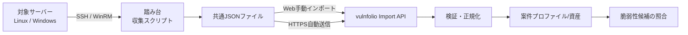

# データ収集・インポート方式（設計案）

- 更新日: 2026-11-19
- 状態: **共通JSON v0.1互換・v0.2（Coverage/Stable Key）、Collector別保存をM1dで実装。Linux/Windows収集コードはM1cで追加（実機未検証）**
- 初期目標: **無料/低運用負荷**、OSや現場ごとの違いを吸収する収集アダプター構成

## 1. 収集経路の分離

1. **公開脆弱性情報:** Vulnerability-Lookup等の公開API・Feederから収集。
2. **SNS・コミュニティ情報:** API/RSS/許諾を確認したWeb収集。既存OSS Sightingsを再利用できる箇所は再利用。
3. **案件資産情報:** Linux/Windowsをエージェントレスで収集。JSON出力→手動アップロード/HTTPS自動送信。
4. **既存スキャナー結果:** Vuls等は将来拡張。初期は現場で脆弱性検査を要求しない。

### 共通コレクター契約（2026-11-19方針確定）

Ansible / Vuls / OpenVAS / 独自スクリプトは、それぞれの出力を**共通のジョブAPI + 正規化レコード**に変換する。上位側は製品固有のコマンド・レポート形式を知らなくてよい。

ただし、**資産観測情報（AssetObservation）**と**スキャナーによる脆弱性判定（VulnerabilityFinding）**は別のデータ型にする。Ansible等がパッケージ一覧しか返さない場合はFindingを作らない。Vuls/OpenVAS由来のFindingには検査方式・証跡・取得時刻を付ける。モジュール単位の取得可能機能はCapabilityで表現する。

初期の実アダプターは軽量インベントリ収集を優先する。Vuls/OpenVASのフル実行連携は後でも、**それらを同じAPIで接続できる境界**は先に確保する。共通API例・サンプルは[モジュール化設計](modularity.md)を参照。**実行可能なAnsible収集PoC**の手順は[M1c](poc-m1c-agentless.md)。

## 2. SNS・コミュニティ情報

| 対象 | 推奨優先取得法 | 留意点 |
| --- | --- | --- |
| CVE/アドバイザリ | 上流API/フィード | 利用条件・差分取得・出典 |
| Bluesky | 公開API/ストリーム等 | 投稿削除・重複・検索範囲 |
| Mastodon | インスタンスAPI等 | インスタンスごとの規約・分散性 |
| Reddit | 公式APIや許諾済みフィード | 制限と再配布ルール |
| GitHub | GitHub API等 | PoC発見だけで「攻撃確認」としない |
| 技術ブログ | RSS/Atom / 公開HTTP | 本文転載の権利確認 |
| X | 公式API、許諾された第三者サービスを調査 | **追加課金原則0円**を最優先。無料で全件取得できるとは想定しない |
| JS主体の公開サイト | 可能ならAPI/RSS、必要時Playwright | サイト規約/robots/負荷/認証を尊重 |

### Playwrightの設計方針

- メインのAPIやDBプロセスとは分離した単独の収集ワーカーにする。
- ログインバイパス、CAPTCHA/アクセス制限回避、非公開情報の無断取得を前提にしない。
- ソースごとに取得頻度、エラー時リトライ、ETag等の差分、バックオフ、最終成功時刻を記録。
- サイト変更でワーカーが停止しても、公式脆弱性情報・他ソース・ダッシュボードは動作継続。
- 利用許諾が不明なXなどは収集実装前に個別調査し、許諾のないスクレイピングを既定動作にしない。
- 脆弱性の**言及を観測した事実**、脆弱性そのものの**存在・悪用確認**、投稿内容の**信頼性**を区別する。

### 収集レコードの概念フィールド

`source_id`、`external_id`、`canonical_url`、`published_at`、`observed_at`、`fetched_at`、`language`、`vulnerability_ids[]`、`content_summary`、`content_hash`、`author_pseudonym`（必要な場合のみ）、`rights`/公開条件、`raw_reference`。

- 原文の保存/公開範囲は出典・利用許諾による。
- CVEが無い段階の情報には暫定 `threat_event_id` を付ける。
- 同一投稿の再取得・引用RT・他プラットフォーム転載を「独立した多数の裏付け」と誤判定しない。
- 話題件数の時系列は**実際に収集できた範囲の観測値**として扱う。X取得範囲が限定的な場合に全世界の注目度と断定しない。

## 3. エージェントレス資産収集

### 初期スコープ（合意）

- Linux + Windowsから開始。ネットワーク機器は後からドライバー追加。
- 踏み台サーバー等でスクリプトまたはAnsible等を実行し、ホスト側の常駐エージェントは不要。
- SSH/WinRM/PowerShell等の読み取り専用処理を基本とする。
- 取得: OS/ディストリビューション、ビルド、インストール済みパッケージ、Windows KB、ソフトウェア名・バージョン等。
- 中央側で正規化・脆弱性の**影響候補**を照合。現場側のVuls等のスキャンは初期対象外。
- 手動JSONインポート**と**HTTPSアップロードを共通形式で両対応。
- 閉域網でも「収集→ファイル生成」まで完結させる。

### データの論理フロー



### 実装済みの収集JSON契約（v0.1.0）

**v0.1互換仕様は[旧CollectionEnvelope](contracts/collection-envelope-v0.1.md)、新規は[M1d v0.2](poc-m1d-data-quality.md)と[JSON Schema](../contracts/collection-envelope-0.2.0.schema.json)**（[コード](../src/vulnfolio/contracts.py)）を参照。以下は**v0.1の旧形式による簡略例**であり、当初の`schema_version: 0.1-draft`、`profile_ref`、`assets`を用いた旧案は現行Importerに受理されません。

```json
{
  "schema_version": "0.1.0",
  "profile_id": "profile-id-from-web",
  "collector": {"driver": "ansible", "capabilities": ["asset_inventory", "installed_packages", "windows_kb"]},
  "observed_at": "2026-11-19T00:00:00Z",
  "status": "success",
  "observations": [{
    "asset_id": "test-linux",
    "os": {"family": "Debian", "distribution": "Ubuntu", "version": "24.04", "build": null},
    "packages": [{"name": "openssl", "version": "example", "epoch": null, "release": null, "arch": "amd64", "manager": "apt"}],
    "patches": [],
    "inventory_scope": "reported",
    "source": "ansible"
  }],
  "findings": [],
  "errors": []
}
```

- `observations`は資産観測、`findings`はスキャナーの判定で別物です。
- M1bの**ローカル手動インポートは実装済み**。`findings`が1件でもある場合は全件拒否。Vuls/OpenVASのFindingは未対応。
- **実機向けAnsible/PowerShell収集コードはM1cで追加（実機の通信検証は未実施）**。M1dで**完全・部分・未確認の区別、Collector別の観測保存、安定資産ID、Windows Build保存**を追加。**認証付きHTTPS送信PoCは別モジュールとして追加**（[仕様と制約](poc-m1c-https.md)）。実環境/LAN越しの受入は未実施。Issue #24/#30/#31で進行管理します。
- `os.build`は現行Importerで入力検証のみ実施し、AssetのDB列には保存していません。Windows OSビルド照合は今後の課題。

### 正規化・照合の注意点

- 同一名のパッケージでもOSベンダーの修正バックポートがあり、単純なバージョン比較では誤検知する。
- WindowsはインストールKBだけでなくOSビルド・修正の累積関係を考慮する必要がある。
- 製品名のCPE/PURLへの対応付けは確度と根拠を保存し、誤照合を人が訂正できるようにする。
- ホストを識別する安定キーと表示名を分離。ホスト名変更で意図せず別資産が増殖しないようにする。
- **前回との差分**（新規・更新・消滅・取得失敗）を把握し、取得失敗を「削除」と見なさない。

### 安全性・運用

- パスワード、SSH秘密鍵、トークン、機密な設定ファイル本文、不要な個人情報は収集しない。
- 対象ホストへの設定変更や更新プログラム適用は行わない。最小権限でアクセスする。
- 手動アップロード時もプロファイルの誤指定を防ぐ。実案件データを公開リポジトリに置かない。
- 入力ファイルのサイズ・フォーマット・件数・スキーマバージョンを検証し、重複実行IDを冪等処理する。
- 自動送信ではHTTPS、認証、再送、タイムアウト、通信不能時のローカル保持を検討。
- 「収集できなかった項目」と「存在しないことを確認できた項目」を区別する。

### 方式の整理：OpenVASではなく認証付き資産インベントリを初期採用

ユーザーの想定は、**踏み台からSSH/WinRMでOSにログインし、`rpm -qa` / `dpkg-query` / Windows KB等を収集し、中央で脆弱性情報に照合する**方式。**ポートスキャン・サービス応答からの脆弱性推定を主目的としない**。

- **Ansible/PowerShell:** インベントリ収集の主な実装候補。Linuxは`ansible.builtin.package_facts`などを使い、epoch/release/arch等を落とさず構造化して保存する。
- **Vuls:** Linux系ではSSHでパッケージを調べ、OVAL・OSベンダーのセキュリティアドバイザリと照合する既存OSS。特に**中央照合エンジンの自作を減らす候補**として比較する。ただし利用形態・対象OS・連携方法はPoCで確認する。
- **OpenVAS/Greenbone:** ネットワークスキャンだけでなく、**Authenticated Scan / Local Security Checks / Notus**によりSSH/SMB等でインストール済みパッケージやパッチ状態を収集・照合できる。よって「できない」のではなく、今回必要な処理に対して**全体の検査基盤が大きくなりがち**という理由で初期の第一候補から外す。
- **Vulnerability-Lookup:** 脆弱性情報の集約には有効でも、OS固有のバックポート修正やKB累積関係まで正確に判定できるとは限らない。CVE/CPEの単純文字列一致で「影響あり」を確定しない。

したがって、**初期は軽量インベントリ収集＋中央で影響候補を照合**、その判定精度が不足するときはVuls等の既存マッチング機能の再利用を検証する。OpenVAS相当のアクティブスキャンは今回の必須機能ではない。

参考: [Greenbone Notus / Local Security Checks](https://greenbone.github.io/docs/latest/background)、[Greenbone Authenticated Scan](https://docs.greenbone.net/GSM-Manual/gos-24.10/en/scanning.html)、[Vuls](https://vuls.io/)、[Ansible package_facts](https://docs.ansible.com/projects/ansible/latest/collections/ansible/builtin/package_facts_module.html)。

## 4. 将来の拡張ポイント

- ネットワーク機器向け（FortiOS/Cisco/Aruba等）CLI/API/SNMPアダプター
- Vuls、Trivy、SBOM等が生成する検査結果を**別種の観測データ**として受け入れる
- NetBox/監視/台帳/CMDB/CSVからの資産情報取得
- 案件ごとの収集ポリシー、除外条件、資格情報のローカル管理
- 追加ソーシャルフィード、取得成功率・コストの観測

実装判断は[ロードマップ](roadmap.md)とPoCで行う。
