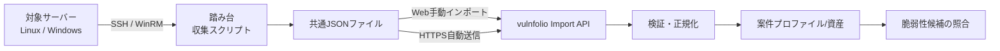

# データ収集・インポート方式（設計案）

- 更新日: 2026-11-19
- 状態: **方針は合意、具体スキーマ・収集コマンドは未確定**
- 初期目標: **無料/低運用負荷**、OSや現場ごとの違いを吸収する収集アダプター構成

## 1. 収集経路の分離

1. **公開脆弱性情報:** Vulnerability-Lookup等の公開API・Feederから収集。
2. **SNS・コミュニティ情報:** API/RSS/許諾を確認したWeb収集。既存OSS Sightingsを再利用できる箇所は再利用。
3. **案件資産情報:** Linux/Windowsをエージェントレスで収集。JSON出力→手動アップロード/HTTPS自動送信。
4. **既存スキャナー結果:** Vuls等は将来拡張。初期は現場で脆弱性検査を要求しない。

## 2. SNS・コミュニティ情報

| 対象 | 推奨優先取得法 | 留意点 |
| --- | --- | --- |
| CVE/アドバイザリ | 上流API/フィード | 利用条件・差分取得・出典 |
| Bluesky | 公開API/ストリーム等 | 投稿削除・重複・検索範囲 |
| Mastodon | インスタンスAPI等 | インスタンスごとの規約・分散性 |
| Reddit | 公式APIや許諾済みフィード | 制限と再配布ルール |
| GitHub | GitHub API等 | PoC発見だけで「攻撃確認」としない |
| 技術ブログ | RSS/Atom / 公開HTTP | 本文転載の権利確認 |
| X | 公式API、許諾された第三者サービスを調査 | **追加課金原則0円**を最優先。無料で全件取得できるとは想定しない |
| JS主体の公開サイト | 可能ならAPI/RSS、必要時Playwright | サイト規約/robots/負荷/認証を尊重 |

### Playwrightの設計方針

- メインのAPIやDBプロセスとは分離した単独の収集ワーカーにする。
- ログインバイパス、CAPTCHA/アクセス制限回避、非公開情報の無断取得を前提にしない。
- ソースごとに取得頻度、エラー時リトライ、ETag等の差分、バックオフ、最終成功時刻を記録。
- サイト変更でワーカーが停止しても、公式脆弱性情報・他ソース・ダッシュボードは動作継続。
- 利用許諾が不明なXなどは収集実装前に個別調査し、許諾のないスクレイピングを既定動作にしない。
- 脆弱性の**言及を観測した事実**、脆弱性そのものの**存在・悪用確認**、投稿内容の**信頼性**を区別する。

### 収集レコードの概念フィールド

`source_id`、`external_id`、`canonical_url`、`published_at`、`observed_at`、`fetched_at`、`language`、`vulnerability_ids[]`、`content_summary`、`content_hash`、`author_pseudonym`（必要な場合のみ）、`rights`/公開条件、`raw_reference`。

- 原文の保存/公開範囲は出典・利用許諾による。
- CVEが無い段階の情報には暫定 `threat_event_id` を付ける。
- 同一投稿の再取得・引用RT・他プラットフォーム転載を「独立した多数の裏付け」と誤判定しない。
- 話題件数の時系列は**実際に収集できた範囲の観測値**として扱う。X取得範囲が限定的な場合に全世界の注目度と断定しない。

## 3. エージェントレス資産収集

### 初期スコープ（合意）

- Linux + Windowsから開始。ネットワーク機器は後からドライバー追加。
- 踏み台サーバー等でスクリプトまたはAnsible等を実行し、ホスト側の常駐エージェントは不要。
- SSH/WinRM/PowerShell等の読み取り専用処理を基本とする。
- 取得: OS/ディストリビューション、ビルド、インストール済みパッケージ、Windows KB、ソフトウェア名・バージョン等。
- 中央側で正規化・脆弱性の**影響候補**を照合。現場側のVuls等のスキャンは初期対象外。
- 手動JSONインポート**と**HTTPSアップロードを共通形式で両対応。
- 閉域網でも「収集→ファイル生成」まで完結させる。

### データの論理フロー



### 収集JSONの例（**最終仕様ではない**）

```json
{
  "schema_version": "0.1-draft",
  "collection_id": "8fa16ae3-3a2f-4947-a8b6-2b73ff4f7103",
  "collected_at": "2026-11-19T00:00:00Z",
  "profile_ref": "example-profile",
  "collector": {
    "name": "vulnfolio-agentless",
    "version": "0.0.0-proposal"
  },
  "assets": [
    {
      "external_asset_id": "server-001",
      "host_type": "server",
      "os": {
        "family": "linux",
        "distribution": "ubuntu",
        "version": "24.04",
        "architecture": "amd64"
      },
      "software": [
        {
          "name": "openssl",
          "version": "example-version",
          "package_manager": "dpkg",
          "source": "package_facts"
        }
      ],
      "patches": []
    }
  ]
}
```

※ この例のソフトのバージョンはダミー。実際にはパッケージのrelease/epoch/アーキテクチャ、Windowsビルド/KB/製品識別情報、取得成否などが必要になる。

### 正規化・照合の注意点

- 同一名のパッケージでもOSベンダーの修正バックポートがあり、単純なバージョン比較では誤検知する。
- WindowsはインストールKBだけでなくOSビルド・修正の累積関係を考慮する必要がある。
- 製品名のCPE/PURLへの対応付けは確度と根拠を保存し、誤照合を人が訂正できるようにする。
- ホストを識別する安定キーと表示名を分離。ホスト名変更で意図せず別資産が増殖しないようにする。
- **前回との差分**（新規・更新・消滅・取得失敗）を把握し、取得失敗を「削除」と見なさない。

### 安全性・運用

- パスワード、SSH秘密鍵、トークン、機密な設定ファイル本文、不要な個人情報は収集しない。
- 対象ホストへの設定変更や更新プログラム適用は行わない。最小権限でアクセスする。
- 手動アップロード時もプロファイルの誤指定を防ぐ。実案件データを公開リポジトリに置かない。
- 入力ファイルのサイズ・フォーマット・件数・スキーマバージョンを検証し、重複実行IDを冪等処理する。
- 自動送信ではHTTPS、認証、再送、タイムアウト、通信不能時のローカル保持を検討。
- 「収集できなかった項目」と「存在しないことを確認できた項目」を区別する。

## 4. 将来の拡張ポイント

- ネットワーク機器向け（FortiOS/Cisco/Aruba等）CLI/API/SNMPアダプター
- Vuls、Trivy、SBOM等が生成する検査結果を**別種の観測データ**として受け入れる
- NetBox/監視/台帳/CMDB/CSVからの資産情報取得
- 案件ごとの収集ポリシー、除外条件、資格情報のローカル管理
- 追加ソーシャルフィード、取得成功率・コストの観測

実装判断は[ロードマップ](roadmap.md)とPoCで行う。
