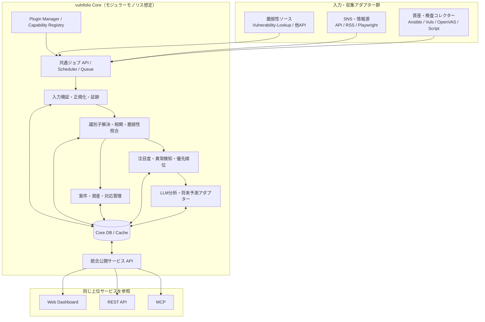

# モジュールアーキテクチャ基本方針

- 更新日: 2026-11-19
- 状態: **ユーザーと合意したモジュール化方針**と、それを満たすための**設計案**
- 位置付け: [アーキテクチャ](architecture.md)を補完する横断的な契約。具体クラス名・実行ランタイムはPoC後に固定
- 最優先原則: **異なる実装を上位レイヤーへ漏らさず、交換・併用・追加できること**

## 1. 設計原則（合意）

1. **収集方式に依存しない共通APIを設ける。** Ansible、Vuls、OpenVAS/Greenbone、独自スクリプトが、上位からは同じジョブ実行/結果取得の操作体系で扱えること。
2. **個別ツールの差異はアダプターと正規化層で吸収する。** ただし、取得可能な項目や検出能力の違いを捏造・隠蔽しない。
3. **収集以外も可能な範囲でモジュール化する。** 公式脆弱性ソース、SNS、正規化、照合、評価、AI、保存先、出力先を交換・追加可能にする。
4. **上流OSS本体のfork/改変を最小限にし、標準API/出力で連携する。**
5. **モジュラー＝マイクロサービス化ではない。** 個人運用・低コストが優先なので、初期はモジュラーモノリス＋必要な独立ワーカー程度にとどめる。
6. **有効化するモジュールは用途・案件プロファイルごとに選べる設計**を目指す。ただし初期UIで全設定機能を実装する必要はない。

## 2. 全体ブロック図



*この図は論理構成であり、各箱を別コンテナ・別プロセスにする意味ではない。* 公式脆弱性ソース側の同期と手動JSONインポートは、ジョブ経路への入力形態の一つとして扱う。LLMはMCP側クライアント等から結果を書き戻す構成も検討する。

## 3. モジュール区分と共通契約（設計案）

| 種別 | 主な候補実装 | Coreに見せる共通契約 | 初期の実装目標 |
| --- | --- | --- | --- |
| Vulnerability Source | Vulnerability-Lookup API / ローカル本体 / 将来OpenCTI等 | 検索、取得、差分同期、出典 | VL APIアダプター |
| Asset Collector | Ansible / PowerShell・SSHスクリプト / Vuls / OpenVAS | 能力照会、実行依頼、実行状態、結果取込 | Ansible/軽量スクリプト |
| Vulnerability Findings Importer | Vuls / OpenVAS / Trivy等 | スキャン結果の取込→共通Finding | 将来 |
| Social Source | Bluesky / GitHub / RSS / Mastodon / X（許諾・費用条件） | 差分収集、Evidence/Signal変換 | 低コストAPI/RSSから |
| Normalizer | OS・パッケージ・CPE/PURL・IDマッピング | 入力形式→版付きCanonical Record | Core標準 |
| Matcher | CPE・PURL・ベンダーアドバイザリ・将来OSSエンジン | 観測資産と脆弱性の候補照合＋根拠 | 候補照合 |
| Scorer / Detector | CVSS/KEV/EPSS/SNSトレンド | 独立指標・異常イベント・根拠 | ルールベース |
| Analyzer / Forecast | ChatGPT/Claude正規MCPクライアント、将来ローカルLLM | 分析ジョブ入出力、結果検証 | キュー＋手動/実行可能な定期ワークフロー |
| Storage | PostgreSQL、外部キャッシュ等 | リポジトリAPI／永続化・取得 | PostgreSQL候補。実装上の抽象は過剰にしない |
| Publisher | Web/REST/MCP | 権限付き共通照会サービス | Web・REST先行、MCP追加 |

**モジュール独立性の重要度:** 外部サービスや検査エンジンの差し替えが想定される境界はプラグイン化する。すべての内部クラスに汎用プラグインAPIを要求しない（保守コストが増えるため）。

## 4. 「同一API」の意味

Ansible・Vuls・OpenVASに対して、上位は次のような**単一の抽象操作**だけを使う。

```text
Collector.capabilities() -> CapabilitySet
Collector.validate_config(profile, config_ref) -> ValidationResult
Collector.collect(job_spec) -> JobHandle
Collector.get_status(job_id) -> JobStatus
Collector.get_results(job_id, cursor) -> CollectionEnvelope
Collector.cancel(job_id) -> OperationResult (optional)
```

これらは**概念契約であり確定したエンドポイントや実装シグネチャではない**。手動で持ち込むJSONも `CollectionEnvelope` へ変換するインポートアダプターで接続する。

### 能力の違いはCapabilityとして公開

| Capability | Ansible/スクリプト | Vuls | OpenVAS |
| --- | --- | --- | --- |
| OS・インストール済みパッケージの観測 | 対応を目指す | 対象OS・モード次第 | 認証付き検査・モード次第 |
| Windows KB/製品情報 | 収集実装次第 | 対象Windows用機能・モード次第 | 認証方式・検査設定次第 |
| 脆弱性Finding出力 | 原則なし | あり | あり |
| ネットワーク探索/アクティブ検査 | 原則なし | 基本スコープ外 | あり |
| オフラインJSON持ち込み | 自前の共通形式 | エクスポート/変換により対応検証 | エクスポート/変換により対応検証 |

この表は厳密な製品互換性一覧ではない。対象OS、認証、スキャン設定、出力形式のPoCで更新する。

**重要:** 共通APIにより操作方法は揃えられるが、**検査手段の実行方法・取得深度・精度・負荷・検査リスクは揃わない**。例えばAnsibleがパッケージ一覧しか返さなければ `Finding` は生成せず、`observations` を返すだけ。OpenVASがアクティブ検査を要する機能は明示的に許可しない限り実行しない。

## 5. 正規化データ契約（案）

収集結果を2つの独立した情報種別に分ける。

1. **AssetObservation**: ホスト、OS、パッケージ、KB、製品、バージョン、収集時刻・方式。取得した事実の記録。
2. **VulnerabilityFinding**: 特定資産に対してスキャナーが主張する脆弱性・証拠・検査ルール・信頼度・検査時刻。脆弱性の存在が自動的に確定したことを意味しない。

```json
{
  "schema_version": "0.1-proposal",
  "job_id": "example-run-001",
  "profile_ref": "example-profile",
  "collector": {
    "type": "ansible",
    "version": "example-version"
  },
  "started_at": "2026-11-19T00:00:00Z",
  "completed_at": "2026-11-19T00:01:00Z",
  "status": "partial_success",
  "capabilities_used": ["asset_inventory"],
  "observations": [
    {
      "asset_ref": "server-001",
      "os_family": "linux",
      "os_distribution": "rhel",
      "os_version": "9",
      "packages": [{"name": "openssl", "version": "example", "release": "example", "arch": "x86_64"}]
    }
  ],
  "findings": [],
  "errors": [{"asset_ref": "server-002", "category": "connection_failed"}]
}
```

- 実データに合わせてJSON Schema/OpenAPIを決める。ここに掲載したキーや値は**暫定例**。
- 取得時刻、元データ/出典、ツールバージョン、権限/取得方法、部分成功、欠損、再試行を保持する。
- `null`/空配列/未対応/取得失敗を区別する。結果が空でも「脆弱性なし」とは断定しない。
- 共通IDと上流ツール独自IDは双方保持。二重インポート時に同一ジョブを再反映しない。
- セキュリティ上、認証情報自体は出力しない。秘密情報は踏み台/収集側に置き、中央へは参照IDだけ送る。

## 6. 設定・実行の考え方

```yaml
# 設計説明用。実際の設定ファイル仕様ではありません
collectors:
  linux-inventory:
    driver: ansible
    capabilities: [asset_inventory]
  credentialed-scan:
    driver: vuls
    capabilities: [asset_inventory, vulnerability_findings]
profiles:
  example-profile:
    enabled_collectors: [linux-inventory]
```

- 案件ごとに使用可能な収集方式/権限/ネットワーク制約を切り替える。
- 同一案件に複数コレクターを接続することも検討。ただし同一資産・同一CVEの二重集計を防止する。
- 自動収集とファイル手動インポートは、どちらも同じ正規化パイプラインを通す。
- 非同期実行・スケジューラ・タイムアウト・再試行・取り消しを共通ジョブ管理に寄せる。
- コアはコレクターがSSHかPlaywrightかを知らず、ただし**検査の種類と実行リスク**は明示的に許可する。
- 外部ツールはバイナリ/コンテナ/HTTP/ローカルCLIなど複数の接続方式を許容。まずは既存実行プロセスのラッパーと出力変換で対応する。

## 7. 境界ごとの実装上の注意

### 7.1 観測→脆弱性判定は分ける

- `AssetObservation` は中央照合エンジンが使う。ベンダーの修正バックポート/KB累積などを考慮する。
- `VulnerabilityFinding` はスキャナーによる個別の判定結果。Coreの評価に証跡として加える。
- 判断が食い違った場合は、**根拠と照合時刻ごと併記**し、優先順位・確度はルールで決める。無理に単一の「真実」へ潰さない。

### 7.2 入力系と出力系も交換可能に

- Vulnerability-Lookupを外部API/セルフホストへ切り替えても、Coreが受け取る脆弱性モデルは同じ。
- SNSソースはアクセス可能な無料API/RSS/許諾されたPlaywright収集へ切り替えられる。
- 数値スコア計算とLLM定性分析を分離し、LLMが使えなくてもCoreが稼働。
- Web/REST/MCPは**同じアプリケーションサービス**を利用し、実装ごとに異なるランキングロジックを持たせない。
- ストレージ交換はアプリケーション層の依存を限定する程度にとどめ、将来DBを自由に差し替えるためだけの巨大な抽象化は避ける。

### 7.3 運用・セキュリティ

- 公開情報と内部案件データは認可境界を分離。
- サードパーティのアダプターを任意実行できる汎用プラグイン市場は初期スコープ外。**登録済みアダプターのみロード**する。
- アクティブ検査は収集対象への負荷や変更を伴う可能性があるため、`active_scan` capabilityと明示的な許可を必須とする。
- 実行ログ、失敗、プロファイル、収集元、処理版、相関根拠が追跡できるようにする。

## 8. 検証と受入条件

- [ ] Ansible/独自スクリプトで生成した収集結果を共通取込APIへ投入できる。
- [ ] Vulsの結果を別アダプターから投入しても、CoreとUIの呼び出し仕様を変更せず表示できる。
- [ ] OpenVASは実機スキャンがなくても保存済みレポートを用いてアダプター形式を検証できる。
- [ ] 同一資産/CVEに複数由来の根拠があっても二重集計せず、根拠は保持する。
- [ ] あるプラグインを無効化/失敗させても、他の取得元やWeb UIは継続する。
- [ ] 追加ソースのためにCoreの正規化スキーマや統合APIを頻繁に破壊的変更しない。
- [ ] API/JSONスキーマに版を付与し、互換性テストを整備する。
- [ ] 交換可能性のための抽象化が、個人運用コストを大きく悪化させていない。

## 9. 実装順（モジュラー設計を先行し、実体は段階導入）

1. Coreの**共通データ契約・アダプター契約・ジョブ管理**を小さく定義する。
2. Vulnerability-Lookup Source Adapterと、JSON Import Adapter、軽量Ansible/PowerShell Collectorを実装する。
3. REST/Webの基本機能を完成させ、検証用の模擬Vuls/OpenVAS変換アダプターで契約互換性を試す。
4. SNSソース、スコアリング、LLM、MCPを追加する。
5. 実際のVuls/OpenVAS、ネットワーク機器等のアダプターは必要になった時に追加する。

**vulnfolioでは「プラグインが何でもできる」ことより、「機能ごとの責務・データ契約を安定させ、特定OSSに依存しない」ことを優先する。**

関連: [要件](requirements.md) / [全体構成](architecture.md) / [収集方式](data-ingestion.md) / [ロードマップ](roadmap.md)
