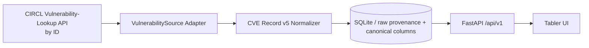

# M0 — Walking Skeleton（公開CVE → DB → REST → Web）

- 2026-11-19
- 対応: [M0 Epic #3](https://github.com/zawa356/vulnfolio/issues/3)
- スコープ: **1種類の実データソースを使った「動く縦スライス」**（[PR #14](https://github.com/zawa356/vulnfolio/pull/14)、[受入PR #17](https://github.com/zawa356/vulnfolio/pull/17) で完了）
- この文書は**M0完成時点の記録**。SNS/LLM/案件照合/大規模同期はM0対象外。案件管理は後のM1a/M1bで追加済み。

## 構成



既存のAnsible/Vuls/OpenVASアダプターは別モジュールであり、Phase 0ではDBとの連携はしていなかった。**M1bで`AssetObservation`のローカルJSON手動インポートを接続済み**（[実装](poc-m1-import.md)）。Vuls/OpenVASのFinding取込は未実装。

## 起動

Python 3.11以上。

```bash
python -m venv .venv
. .venv/bin/activate
python -m pip install -e .

# 既知のCVEを少数だけ取得（各IDに1 HTTPリクエスト）
python -m vulnfolio.vulnerability_sync --id CVE-2024-3094 --id CVE-2024-38063

# 常駐サービスをLANに公開せずローカルで起動
uvicorn vulnfolio.vulnerability_api:app --host 127.0.0.1 --port 8000
```

- Web: <http://127.0.0.1:8000/>
- OpenAPI: <http://127.0.0.1:8000/docs>
- Local REST: <http://127.0.0.1:8000/api/v1/vulnerabilities>
- Health: <http://127.0.0.1:8000/api/v1/health>

Windows PowerShellでは `.venv\Scripts\Activate.ps1` を使用。PowerShellでのコマンドは次のとおり。

```powershell
py -m venv .venv
.\.venv\Scripts\Activate.ps1
python -m pip install -e .
python -m vulnfolio.vulnerability_sync --id CVE-2024-3094
uvicorn vulnfolio.vulnerability_api:app --host 127.0.0.1 --port 8000
```

DBは既定で `data/vulnfolio.db`。別の保存先を使う場合は `VULNFOLIO_DB` 環境変数を設定し、同期コマンド/サーバーで同じ値を使う。データフォルダーはGit管理対象外。

`uvicorn ...:app` は起動時にDBを初期化する。**公開APIへのアクセスは同期コマンドを明示実行した時だけ**。ダッシュボード閲覧ではCIRCL APIを呼び出さない。インターネット接続がなくても過去の収集済みデータを閲覧できる。

### Tabler

UIは既存Bootstrap系キット[Tabler](https://github.com/tabler/tabler)の標準ナビ・カード・表を使う。PoCはバージョン固定のCDN `@tabler/core@1.7.5` をロードするため、**UIスタイルの読み込みにはブラウザの外向き通信が必要**。CSS/JSのローカル同梱は配布前に対応する。

## レスポンス

`GET /api/v1/vulnerabilities?q=openssh&page=1&per_page=25`

```json
{
  "metadata": {"count": 1, "page": 1, "per_page": 25},
  "data": [
    {
      "id": "CVE-2099-12345",
      "title": "Example synthetic vulnerability",
      "description": "Synthetic record for tests only.",
      "published_at": "2099-01-02T03:04:05Z",
      "updated_at": "2099-01-03T03:04:05Z",
      "cvss_score": 8.1,
      "cvss_severity": "HIGH",
      "references": ["https://example.invalid/security/CVE-2099-12345"],
      "provider": "vulnerability-lookup",
      "source_url": "https://vulnerability.circl.lu/api/vulnerability/CVE-2099-12345",
      "first_fetched_at": "2099-01-04T00:00:00+00:00",
      "fetched_at": "2099-01-04T00:00:00+00:00"
    }
  ]
}
```

*上記は説明用の架空サンプル（実際にAPIから取得できたCVEではない）。* Raw CVE RecordはローカルDBに証跡として保持するが、公開RESTには返さない。

## 実API調査（2026-11-19）

- **実測:** `GET https://vulnerability.circl.lu/api/vulnerability/CVE-2024-3094` がHTTP成功し、`dataType=CVE_RECORD`、`dataVersion=5.2`、`cveMetadata.cveId`、`cveMetadata.datePublished`、`dateUpdated`、`containers.cna.descriptions`等を確認。
- **機械可読ポリシー実測:** [/.well-known/api-policy.json](https://vulnerability.circl.lu/.well-known/api-policy.json) に匿名20リクエスト/分、認証40リクエスト/分と表示。User-Agentで自動クライアントを識別し、APIを列挙してミラーしないこと。差分同期には `/api/vulnerability/?since=...` を利用。
- **EPSS実測:** `GET /api/epss/CVE-2024-3094` は `status:OK` と `data[0].cve/epss/percentile/date` を含むJSONを返した。EPSS値は取得時点のものであり、独自予測とは別データとして扱う。
- **Sightings実測:** `GET /api/sighting/?vuln_id=CVE-2024-3094&per_page=1` は `metadata` と `data` のページング形式。各件に `type`、`source`、`creation_timestamp`、`vulnerability` 等がある。
- **差分取得の形状実測:** `GET /api/vulnerability/?since=2026-11-18&per_page=1` は少なくとも当該応答で **JSON配列** を返し、CVE Record以外（例：PYSEC/OSV形式）も含む。これをそのままM0のCVE Recordアダプターへ流し込んではいけない。次段階の増分同期では形式別アダプターを経由する。
- 既存公式ドキュメント: [API](https://www.vulnerability-lookup.org/documentation/api.html) / [Access patterns](https://www.vulnerability-lookup.org/documentation/access-patterns.html)
- **PoCではID指定の手動同期のみ**、1実行最大10件、429時は追加リクエストを止める。自動ループ・全件スキャンは行わない。
- API上流が停止しても既存DBは保持。Healthは最後の同期結果と最終成功時刻を返し、**リアルタイムの上流稼働判定はしない**。

## 制限

- CVE Record形式のみ対応。GCVE/EUVD/CSAF等の上流別データは未対応。
- CVSSはCNA/ADP内の既知メトリクスから抽出できる場合のみ表示。不明ならNULL。
- KEV/EPSS/SightingsはM0の公式API調査対象だが、**現段階でUIへ統合していない**。取得と表示は次のIssueへ。
- オンライン取得は手動ID指定のみ。ソース全件/増分同期は未実装。
- SQLiteはM0の単一ノード小規模PoC用。PostgreSQL移行時もレコード/アダプター契約は維持する。
- **M0のグローバルCVE APIは読み取り専用**。M1a/M1bでは**ローカル限定の案件情報書き込みAPIを追加済み**だが、認証/利用者分離/公開ホスティングは未実装。**127.0.0.1でのみ起動すること**。
- 最終成功日時を記録するが、元データの正しさや実機への影響を保証しない。
- 開発時のネットワーク制限がある場合はモックのCIテストで再現する。**合成テストと公開API実測の区別を明記する**。

## M0受入結果（完了、2026-11-19）

[実CVEからHTTP/HTMLまでのGitHub Actions成功](https://github.com/zawa356/vulnfolio/actions/runs/44445355711) と [Chromium受入テスト成功](https://github.com/zawa356/vulnfolio/actions/runs/44446167894) を証跡とする。

## 受入チェック

- [x] GitHub CI（Python 3.11/3.13）で既存アダプター＋M0テストが成功
- [x] 実CVEsの少数手動同期→DBにupsert
- [x] `GET /api/v1/vulnerabilities` / 個別詳細 / health が正しく動く
- [x] Tabler画面から一覧・検索・詳細・更新状態を確認
- [x] 同一ID再実行で重複ゼロ
- [x] 上流失敗時に古いレコードを失わず、異常状態を画面に出せる
- [x] 実際にサーバーを起動したE2E手順が記録されている
