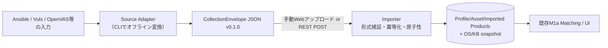

# M1b — 共通収集JSONのローカル手動インポート

- 更新日: 2026-11-19
- 対応Issue: [#23](https://github.com/zawa356/vulnfolio/issues/23)
- 種別: **最小PoC。現場へのSSH接続・HTTPS自動転送・認証はまだ実装していません。**
- 追加API: `POST /api/v1/profiles/{profile_id}/imports`（loopback限定）

## 1. 仕組み



- 収集元固有の形式差異はAdapterで吸収。Importerは**共通形式しか解釈しない**。
- **`observations`のみを台帳に取り込む**。現段階で`findings`に要素があると明示的に422で拒否し、データを黙って失わない。Vuls/OpenVASのFinding保存は後続課題。
- データはProfile IDの一致を必須とし、パッケージを「インポート由来」の独立テーブルに保存するため、手動登録した製品は上書き・削除しない。
- Linuxパッケージの`name/version/epoch/release/arch/manager`を保存。Windowsのパッチ/KB識別子をスナップショットとして保存。ただし**KBとCVEの照合は未実装**。
- 候補照合にはインポートした製品も含める。ただしvendor情報は現在のAnsible形式から得られないことがあり、`vendor unverified`として扱う。

## 2. 実行手順（サンプルは架空データ）

**(1) ローカルWebを起動**（M0/M1aと同じ）。

```bash
python -m pip install -e .
uvicorn vulnfolio.vulnerability_api:app --host 127.0.0.1 --port 8000
```

**(2) ブラウザ** <http://127.0.0.1:8000/environment> でProfileを作成し、表示された**Profile ID**をコピー。

**(3) 踏み台などで取得済みのAnsible JSONを共通形式へ変換。** 自動で実機SSHするCLIではない。

```bash
python -m vulnfolio.cli --driver ansible \
  --profile <profile-id> \
  --input tests/fixtures/ansible.json \
  --output collected-normalized.json
```

ここでの`<profile-id>`はWeb上に表示された実際のIDへ置き換えること。ファイルは**実資産情報を含む可能性があるため、Gitにコミットしない**。

**(4) Webの「Import collected inventory (JSON)」からファイルを選択してアップロード**するか、RESTから取り込む。

```bash
curl -fsS -X POST \
  -H 'Content-Type: application/json' \
  --data-binary @collected-normalized.json \
  http://127.0.0.1:8000/api/v1/profiles/<profile-id>/imports
```

**(5) Asset一覧・Installed software・Potential vulnerability matchesを確認**。初期段階の照合対象は、M0で別途取得している**ローカルに保存済みCVEのみ**。

## 3. 入力契約と安全策

- `schema_version`は**`0.1.0`のみ**。
- URLのProfile IDと`envelope.profile_id`は一致必須。
- 受信`Content-Type`は`application/json`、最大**2 MiB**。200 Assets、各2000パッケージ、合計5000パッケージ、200エラー、2000パッチIDを上限とする。
- 内容の型・文字列長・重複asset_idを検査。バリデーション失敗時は422で全件拒否（部分的な登録を残さない）。
- 同一JSONを同一Profileへ再投入した場合、SHA-256ダイジェストで**冪等化**。2回目は`duplicate:true`を返し、資産・製品を増殖させない。
- 新しいJSONはトランザクションで原子的に反映。実行エラーが起きれば全体ロールバック。
- 同じホスト識別子があれば既存Assetへ紐付ける。現段階では`observation.asset_id`をホスト名として扱うため、**ホスト名変更で別Assetになる可能性**がある。
- 別のProfileへ同名ホストを持ち込んでも混ざらない。
- **取得に失敗したホストや今回のJSONに存在しないホストは、既存台帳から削除しない。**
- ソフト一覧やKB/パッチ一覧が空の場合、収集失敗との区別ができないため**前回の非空インポート済み製品・KB情報を削除しない**（古い情報が残る可能性はある）。
- 新しい非空パッケージ一覧を取得できたホストについては、そのホストの**以前のインポート由来製品だけ**を置換。手動入力した製品は残す。
- `errors`は件数を記録し、認証エラーメッセージ原文等の秘密が混入する危険を避けるため保存しない。
- 先行実装のMatcherはCVE `affected` の**製品名**による保守的候補照合。RPMのepoch/releaseやKBの詳細情報は保存するが、**まだ修正バージョンの自動判定には使っていない**。

## 4. API

| API | 用途 |
| --- | --- |
| `POST /api/v1/profiles/{profile_id}/imports` | JSON取り込み |
| `GET /api/v1/profiles/{profile_id}/imports` | 過去の取り込みバッチ概要（最大100件） |
| `GET /api/v1/assets/{asset_id}/inventory` | 最後に報告されたOS/KB等のスナップショット |
| `GET /api/v1/assets/{asset_id}/products` | 手動/インポート由来の両方を含む製品一覧 |

成功レスポンス例：

```json
{
  "import_id": "a08c0a0ef90b493eac7da657437b89bb",
  "duplicate": false,
  "assets_seen": 2,
  "error_count": 1,
  "collector": "ansible"
}
```

## 5. セキュリティ・適用範囲

**ローカルPoC専用。実案件の情報をこの段階で投入しないこと。**

Private APIはloopbackピアに限定し、Webの異Origin要求を拒否する。ただし**認証・利用者分離・本格的なCSRF保護・資格情報管理は未実装**。リバースプロキシ経由で外部公開したり、信頼できないローカルプロセスへアクセスを許したりしないこと。

将来のHTTPSアップロード・顧客/案件データの業務利用には、認証・アクセス制御・スキーマ版管理・保存時暗号化・監査・セキュリティレビューが必要。

## 6. テスト

```bash
python -m unittest discover -s tests -v
node --check src/vulnfolio/web/environment.js
```

- 合成Linux/RHEL・WindowsのAnsible JSONを使って、収集失敗・RPMのepoch/release/arch・KB・冪等性・手動データ保持・プロファイル分離を検証。
- Chromium受入では、ブラウザからJSONアップロード→Asset/Product登録→CVE影響候補までの表示を確認。
- テストではCIRCL APIへ通信しない。

関連：[M1aのProfile/Asset/候補管理](poc-m1.md) / [モジュール化](modularity.md) / [収集設計](data-ingestion.md)
