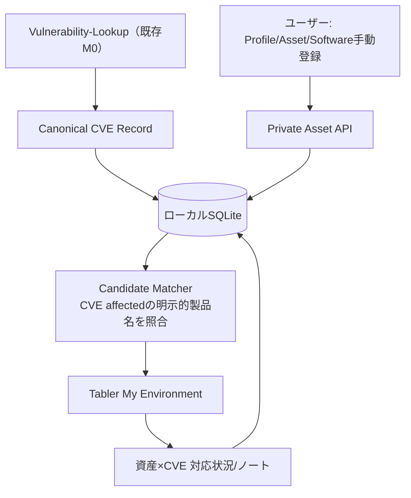

# M1a — 案件Profile・資産登録・CVE影響候補（Vertical Slice）

- 更新日: 2026-11-19
- 対応Issue: [#18](https://github.com/zawa356/vulnfolio/issues/18) / [#19](https://github.com/zawa356/vulnfolio/issues/19) / [#20](https://github.com/zawa356/vulnfolio/issues/20) / [#21](https://github.com/zawa356/vulnfolio/issues/21)
- 状態: **認証なしのローカルPoC。業務・顧客資産を投入しないこと。**
- 目的: M0の公式CVE取得の上に、案件ごとの資産登録、影響**候補**の一覧、手動対応判定を追加する。

## 全体のデータフロー



### モジュールの責務

| モジュール | 内容 |
| --- | --- |
| `asset_storage.py` | Project Profile、Asset、Installed Software、Assessment、変更履歴のSQLite CRUD |
| `asset_matching.py` | **構造化CVE Recordの affected** とInstalled Softwareを照合。CVE本文の文字列検索では候補にしない |
| `asset_api.py` | ローカル限定のREST API。入力検証、エラー、同一Origin制御 |
| `web/environment.html` | Tabler標準パーツによる案件/資産画面 |
| `web/environment.js` | Profile/Asset/Productの追加、候補表示、手動判定保存 |
| `tests/test_m1_assets.py` | 複数案件の独立性、重複、判定履歴、照合誤判定、秘密情報分離 |
| `scripts/m1_browser_smoke.py` | Chromiumを使ってUI入力～再読み込みまで受入試験 |

## 起動方法

既存M0と同じPython環境を使用する。既知CVEの同期後、以下を起動する。

```bash
python -m pip install -e .
python -m vulnfolio.vulnerability_sync --id CVE-2024-3094
uvicorn vulnfolio.vulnerability_api:app --host 127.0.0.1 --port 8000
```

- グローバル脆弱性画面: <http://127.0.0.1:8000/>
- **My Environment:** <http://127.0.0.1:8000/environment>
- API仕様: <http://127.0.0.1:8000/docs>

操作例：

1. Profileに `Lab` などを登録
2. Profile内にAsset `test-linux` とOS情報を登録
3. そのAssetへインストール製品名・vendor・versionを追加
4. 「Potential vulnerability matches」に、**ローカルDBへ収集済みのCVE Record** と一致する製品があれば、影響候補として表示
5. New / Investigating / In progress / Mitigated / Not affected / Accepted risk から手動ステータスを保存
6. Mitigated / Not affected / Accepted risk はデフォルト一覧から除外（「Show handled / excluded」で再表示）

`CVE-2024-3094`は公開APIの動作確認に用いる既知の例。実際に候補としてヒットするかは上流の`affected`の記載内容、製品名、vendor、versionが一致するかに依存する。**任意のCVEを指定しても必ず候補が出るわけではない。**

## M1aのREST API（すべてローカル限定）

| Method/Path | 内容 |
| --- | --- |
| `GET /api/v1/profiles` | プロファイル一覧 |
| `POST /api/v1/profiles` | 作成 |
| `GET /api/v1/profiles/{profile_id}` | 詳細 |
| `GET /api/v1/profiles/{profile_id}/assets` | 資産一覧 |
| `POST /api/v1/profiles/{profile_id}/assets` | 資産登録 |
| `GET /api/v1/assets/{asset_id}/products` | 製品一覧 |
| `POST /api/v1/assets/{asset_id}/products` | 製品登録 |
| `DELETE /api/v1/products/{product_id}` | 誤登録製品の削除 |
| `GET /api/v1/profiles/{profile_id}/candidates?include_closed=false` | 影響候補の照合・状態表示 |
| `PUT /api/v1/assets/{asset_id}/assessments/{cve_id}` | 影響・対応状態/ノートを保存 |
| `GET /api/v1/assets/{asset_id}/assessments/{cve_id}/history` | 変更履歴 |

Profile/Assetの削除や一括編集、共有権限、承認フローは初期実装に含まない。

### 照合の仕様（大事）

- CVE 5.xの`containers.cna.affected`（ほかADPの`affected`）に**構造化された製品名**がある場合のみ比較
- 製品名は前後空白/大文字小文字を正規化して厳密一致。推測のCPE化、説明文の曖昧検索はしない
- 両方にvendorが記載され異なる場合はマッチさせない。片方が空欄なら「vendor未検証」と表示
- `versions[].version`で**完全一致＋status=affected**が見つかった場合、`exact_version_listed_affected` と表記
- `versions[].version`が完全一致し`status=unaffected`と明記されている場合は、そのソースに基づいて当該候補を出さない
- それ以外は**`product_only`（製品名だけ一致、バージョン・更新状態は未判定）**。比較不能な`lessThan`等のバージョン範囲は勝手に評価しない
- 複数の製品が同じ資産/CVEに一致した場合は候補を1行に集約し、より具体的な根拠を代表表示する
- **バックポート修正、Windows KB累積更新、設定条件、配布元パッチは確認していない**。常に影響候補であり、脆弱性確定を意味しない
- 最大**先頭2,000件のローカルCVEレコード**を逐次走査（DBのID順）。超過すると`metadata.complete=false`を返し、画面で**INCOMPLETE COVERAGE**を表示。無関係と断定しない
- 対応状況は`asset_id + cve_id`ごとに保持し、他案件へ影響しない。更新内容が変わった場合のみ変更履歴を追加する

### セキュリティと運用上の制限

**公開運用しない。** 現段階では認証・複数利用者分離が存在しない。

- Private APIと`/environment`は**接続元がloopback**の場合だけ許可する。ブラウザから異なるOriginを指定したリクエストも拒否する
- ただしこれは**認証の代用品ではない**。リバースプロキシ・SSHトンネル等がリモート接続をloopbackに見せる場合や、ローカルプロセスの通信には無防備
- `uvicorn --host 127.0.0.1`でのみ起動し、実案件・顧客の構成情報やIPアドレスを投入しない
- すべて同じSQLiteに格納されるが、テーブル/ルートがグローバルCVEと分離されている。ファイル権限・バックアップ暗号化は運用者側が管理する
- TablerはPoCではCDN経由で読み込むため、ブラウザの外部接続がないと見た目が崩れる（機能のDOM処理は実装上独立）
- 一括インポート（Ansible JSON、Vuls/OpenVASレポート）とHTTPS自動アップロードは**後続イテレーション**の対象

## 動作確認

```bash
python -m unittest discover -s tests -v
node --check src/vulnfolio/web/environment.js

# Chromiumを導入している場合
python -m pip install 'playwright>=1.56,<2'
python -m playwright install chromium
python scripts/m1_browser_smoke.py
```

すべてのテストは**架空のCVE・ベンダー・資産のみ**で実行し、CIRCLへのAPIアクセスは発生しない。公開APIの実接続はM0の別テストで検証済み。

## 今後の改善候補

- Ansible等で生成した`AssetObservation`をProfile/Asset/Productへ安全にインポートするアダプター。ホスト識別の安定化、再投入時の冪等性を検討する
- RPM/DEBのepoch/release/arch、WindowsのKB/ビルド、OSベンダーアドバイザリを照合に利用し、初期の誤検出率を減らす
- CVEが増加した際の製品・CVEのインデックス化／マッチングバッチ化（現段階の逐次走査はPoC用）
- Profile横断ビュー・資産廃止/統合・顧客分離・認証・監査・削除・データエクスポート
- Vuls/OpenVASのFindingを別経路で保持し、インベントリだけの候補照合と区別する

[要件](requirements.md) / [モジュール設計](modularity.md) / [ロードマップ Issue #2](https://github.com/zawa356/vulnfolio/issues/2)
