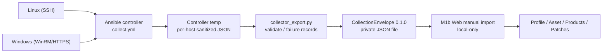

# M1c（前半）— Linux / Windows エージェントレス収集のPoC

- 対応: [Issue #27](https://github.com/zawa356/vulnfolio/issues/27)（親: [Issue #24](https://github.com/zawa356/vulnfolio/issues/24)）
- 状態: **収集コードとオフライン試験**。**実際のLinux/Windowsへの接続試験は未実施**。接続可能な権限ある検証ホストでのみ実施する。
- 結果: OS・ソフト/パッケージ・Windows KB等の**読み取り専用収集** → [CollectionEnvelope v0.1.0](contracts/collection-envelope-v0.1.md) → [M1b手動インポート](poc-m1-import.md)。
- **認証付きHTTPS送信は[別PoC](poc-m1c-https.md)で実装**。収集機能と送信機能は独立し、対象ホストへの実接続・LAN/本番環境は未検証。

## 全体構成



## 1. サポート範囲

| 対象 | 取得するもの | 取得方法 | 制約 |
| --- | --- | --- | --- |
| Linux | OS family/distribution/version | `ansible.builtin.setup`（minimum facts） | OS固有のfact差、ローカル言語等 |
| Linux | RPM/DEB等のパッケージ名・version・epoch・release・arch・manager | `ansible.builtin.package_facts` | パッケージマネージャによって返るフィールドが異なる。リモートのPython/管理用ライブラリが必要な場合がある |
| Windows | OS名・version/build | `Get-CimInstance Win32_OperatingSystem` | CIM/WMI読取権限が必要 |
| Windows | KB番号 | `Get-HotFix` | **全更新の完全リストではない**。累積更新/Feature Update/MSIX等の網羅性を保証しない |
| Windows | HKLM登録済みソフトウェア名・DisplayVersion | HKLMの32/64bit `Uninstall` レジストリを読取 | **MSIX/Store、ユーザー別インストール、ポータブルアプリ等は原則含まれない** |

**`Win32_Product`は使用しません。** MSIの自己修復などの副作用を避けるためです。**設定変更・パッチ適用・アクティブ脆弱性スキャンはしません。** ただしAnsibleモジュールの実行に伴う一時ファイル作成等の内部処理までゼロにはなりません。

公式資料: [Ansible package_facts](https://docs.ansible.com/ansible/latest/collections/ansible/builtin/package_facts_module.html) / [ansible.windows.win_powershell](https://docs.ansible.com/ansible/latest/collections/ansible/windows/win_powershell_module.html)。

## 2. 踏み台への準備

Linux/WSL等のAnsible Controller、Python 3.11+、適切なSSH/WinRM認証を準備する。**ネットワーク対象への実アクセスを行うのは手元で実行した時だけ**。

```bash
python -m pip install -e .
python -m pip install -r collector/ansible/requirements.txt
ansible-galaxy collection install 'ansible.windows:>=3.1.0'

# サンプルは例示IP（192.0.2.x）のみ。実際の認証情報をこのリポジトリへ記載しない。
cp collector/ansible/inventory.example.ini collector/ansible/inventory.ini
# 手元で非公開 inventory.ini を編集し、必要ならAnsible Vault等で認証情報を管理
```

`vulnfolio_linux` / `vulnfolio_windows` という**明示的な2グループ**のホストだけを対象にする。標準`all`グループの全ホストに勝手に接続しない。両方に入ったホストは拒否する。

WindowsはWinRM/HTTPS（5986）、証明書検証有効を推奨する。認証方法は現場のKerberos/NTLM等のポリシーに応じて、**秘密情報をGitや引数へ直書きせず**Ansible Vault・安全な資格情報ストア等で設定する。

## 3. 実行（権限ある検証対象のみ）

```bash
# 1. 構文・対象グループを確認。対象に接続しない。
ansible-inventory -i collector/ansible/inventory.ini --graph
ansible-playbook -i collector/ansible/inventory.ini collector/ansible/collect.yml --syntax-check

# 2. WebのMy Environmentから作成したProfile IDを指定して収集
python -m vulnfolio.collector_export \
  --inventory collector/ansible/inventory.ini \
  --profile <profile-id> \
  --output private-data/inventory-$(date +%Y%m%d%H%M%S).json
```

**Windows PowerShellから直接Ansibleを制御する想定ではなく、Ansible ControllerはLinux/WSLを推奨**。対象WindowsにAnsibleエージェントを常駐させる必要はない。

CLIはインベントリから対象グループのホスト名だけを抽出し、Ansible PlaybookでOS/ソフト情報を収集する。出力JSONは踏み台側に**mode 0600**で保存し、既存ファイルの上書きを拒否。対象ホストへファイルを転送して保存するための設定変更は行わない。

終了コードが1でも**収集に成功したホストがあれば部分結果ファイルを残す**。JSON内の`status`・`errors[]`を確認すること。失敗ホストは`unreachable_or_collection_failed`などの一般的なエラーにまとめ、認証の生エラー文や秘密情報をJSONへ残さない。

出力ファイルは[CollectionEnvelope v0.1.0](contracts/collection-envelope-v0.1.md)。**2MiB上限（M1bと同じ）**、1バッチ最大200ホスト。超えた場合はホストを分割して実行する。

## 4. アップロード（現時点では手動）

1. vulnfolioサーバーを`127.0.0.1`で起動（[M1b手順](poc-m1-import.md)）。
2. 閉域ネットワークなら、出力したJSONを許諾された方法で安全に持ち出す。
3. ブラウザ`/environment`で一致するProfileを選択し、収集JSONを手動アップロードする。
4. Asset、Installed software、候補、Windows KBが登録・表示されることを確認する。

**インベントリ内容を本プロジェクトのGitHubへpushしないでください。** `private-data/`や`collector/ansible/inventory.ini`を`.gitignore`で保護しますが、ほかの出力先でもファイル権限と持ち出し管理が必要です。

## 5. 機能の境界と既知の弱点

- Linux/Windows各1台以上の**実機に対する通信/収集成功はまだ未検証**。CIはAnsible構文検査と合成JSONのオフライン変換のみ。
- Windows `Get-HotFix`の結果は完全な修正インベントリではない。欠落や空は安全・未適用の証明ではない。
- Windows `os.build`は共通JSONでは保存するが、M1bのDB側は**検証するだけで永続化しない**。将来WindowsのKB/ビルド照合前にスキーマ改善が必要。
- 同じ`inventory_hostname`のホストは同一資産とみなす。ホスト名変更/再利用、複数ソース競合を自動解決しない。
- サーバー側M1bは`findings`が非空の場合に取り込まず422を返す。今回のAnsible収集では`findings=[]`。
- コレクターが正常終了したとしても、対象ホストのソフトウェアを全件取得したという保証はない。対象OS・パッケージマネージャ・実行権限によって範囲が変わる。
- **読み取り専用は対象情報の取得処理**の意味。Ansible接続処理やモジュール一時実行の副作用ゼロまでは保証しない。
- **別モジュールの`ingest_upload.py`によるHTTPS送信PoCと受信専用`ingest_server.py`は実装済み**。スケジューリング・本番Ingress・本番認証基盤は未対応（[HTTPS手順](poc-m1c-https.md)）。ローカル管理APIはLAN/インターネットに無認証公開しない。

## 6. CI・受入検証

```bash
python -m unittest discover -s tests -p 'test_collector_export.py' -v
ansible-playbook -i collector/ansible/inventory.example.ini collector/ansible/collect.yml --syntax-check
```

CIは実機にアクセスしない。追加で検証用Linux/Windowsに接続できる環境では、採取したJSONから**秘密情報が含まれていないか・適切な範囲のパッケージが取得できるか・Get-HotFixの欠落傾向**を確認する必要がある。

関連: [全体設計](architecture.md) / [モジュラー設計](modularity.md) / [M1bのインポート仕様](poc-m1-import.md)
