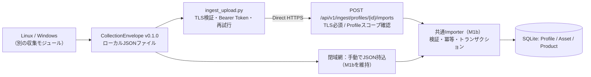

# M1c 後半 — 認証付きHTTPSインベントリアップロード（PoC）

- 対応: [Issue #31](https://github.com/zawa356/vulnfolio/issues/31) / 親 [#24](https://github.com/zawa356/vulnfolio/issues/24)
- 状態: **ローカルの本物のTLS（Uvicorn）で検証するPoC**。LAN/Internetへの本番公開を許可するものではありません。
- 成果: **独立したHTTPS受信専用アプリ（`vulnfolio.ingest_server:app`）**でAgentless収集の共通JSONをProfileスコープのBearer Tokenにより既存M1b Importerへ渡す。通信失敗時は元JSONを残し、同一JSONは重複保存しない。
- 非対象: 実ホストへのSSH/WinRM接続試験（#30）、SaaS向けユーザー認証、複数利用者管理、本番用公開Ingress/Reverse Proxy、監視/WAF/分散レート制限（**PoC単一プロセス内の固定窓制限は実装済み**）。

## 境界とデータフロー



既存の`POST /api/v1/profiles/{id}/imports`、Profile/Asset/Assessmentの取得・変更APIおよび`/environment`は**管理用`vulnfolio.vulnerability_api:app`にのみ登録し、ループバック限定**です。受信専用`vulnfolio.ingest_server:app`には**JSONアップロードのPOSTルートだけ**を登録します。CVE閲覧、Profile/Asset、My Environment、Swagger、OpenAPI、静的ファイル、healthルートは**存在しません（404）**。Tokenは指定Profileのインポート書き込みにだけ使用できます。

## 1. 認証設計

- **トークン**: `vf_`＋暗号学的乱数32バイト（約256ビット）のURL-safe文字列。人間が決める短いパスワードは受理しない設計。
- **認証ファイル v2**: `VULNFOLIO_INGEST_TOKENS_FILE`でパスを指定。JSONには`id`、`profile_id`、`sha256`、`issued_at`、`expires_at`（Unix秒）を格納し、Bearerの平文はサーバー側に保存しない。
- **ファイル権限**: POSIX環境では認証ファイルとBearerファイルに0600相当を要求。WindowsではファイルACLを管理者が設定する（現行PoCはWindows ACLを検査しない）。
- **スコープ**: トークンは発行時に指定した**一つのProfile IDだけ**で有効。他Profileへのアップロードは401。
- **ローテーション**: 新しいトークンを発行→クライアントへ安全に配布→旧トークンIDを失効。資格情報ストアはリクエストごとに再読込するため再起動不要。
- **失効・有効期限**: 個別ID失効に加えて、発行時から**標準7日・最大30日**で失効する。期限切れ・別Profile・取り消し済みはすべて401とし、詳細は返さない。
- **v1→v2の互換性**: 無期限の旧v1 Storeは**自動認証しない（503 fail-closed）**。オペレーターが明示的に移行し、旧Bearerのハッシュへ有限期限を設定する。移行しない限りアップロードは不可。
- **利用監査**: 受信履歴は同じSQLiteの`ingest_audit`に記録し、Token ID、Profile ID、状態、HTTP結果、成功時の資産件数のみ。Bearer値・本文・接続元IPは記録しない。HTTPの監査参照エンドポイントはない。
- **レート制限（PoC）**: Direct TLSのTCP接続元あたり**60回/60秒**、認証済みToken IDあたり**30回/60秒**。429 + `Retry-After`。**単一プロセスのメモリ上限付き固定窓**で、複数Worker/再起動時の共有制限はない。
- `Authorization`をURLのクエリ文字列に含めず、ログやGitに書かない。

## 2. ローカルHTTPS検証の起動例

先に既存M1aの**ループバック専用管理アプリ**でProfileを作成してIDを取得します。その後、**同一SQLiteを参照する別の受信専用アプリ**をHTTPSで起動します。ローカル管理アプリは`127.0.0.1`バインドを維持し、リモートからは接続させません。受信アプリは管理アプリとは**別プロセス・別ポート**です。SQLiteの単一ノードPoCを超える構成や同時大量書込みは未対応です。

### 2.1 テスト用の証明書

実際の運用は自組織/信頼できるCAが発行したサーバー証明書を使います。以下のコマンドは**127.0.0.1でのPoC専用**です。

```bash
mkdir -p private-data/tls private-data/auth
chmod 700 private-data/tls private-data/auth

openssl req -x509 -newkey rsa:2048 -nodes -days 1 \
  -keyout private-data/tls/localhost.key \
  -out private-data/tls/localhost.crt \
  -subj "/CN=localhost" \
  -addext "subjectAltName=DNS:localhost,IP:127.0.0.1"
chmod 600 private-data/tls/localhost.key
```

### 2.2 Profile固有Tokenを発行

```bash
python -m vulnfolio.ingest_credentials issue \
  --store private-data/auth/tokens.json \
  --profile <profile-id> \
  --token-output private-data/auth/collector.token \
  --ttl-hours 168

# ID・スコープの一覧（秘密値は表示しない）
python -m vulnfolio.ingest_credentials list --store private-data/auth/tokens.json
```

- `<profile-id>`をブラウザで作成した32文字IDへ置き換えます。発行CLIはProfileのDB存在を検証せず、**アップロード時にDBとの整合性を検証**します。
- `collector.token`は**平文Bearerが一度だけ書き込まれるファイル**です。安全な手段で踏み台に配布し、0600・適切な所有者/Windows ACLを設定。Gitに追加しないでください。
- サーバー上に残した不要な平文ファイルは、クライアント側の安全な保管を確認した後に削除してください（サーバーのJSON Storeにはハッシュのみが必要）。
- 有効期限一覧: `python -m vulnfolio.ingest_credentials list --store private-data/auth/tokens.json`。Bearerの中身は表示されない。
- 失効: `python -m vulnfolio.ingest_credentials revoke --store private-data/auth/tokens.json --id <token-id>`。
- **旧Store（`schema_version:1`）の移行**: 最初のv2起動前にアクセスを制限した状態でバックアップを取り、`python -m vulnfolio.ingest_credentials migrate --store private-data/auth/tokens.json --ttl-hours 168` を実行。**旧Bearerの平文は再配布せずそのまま使える**が、移行後7日で自動失効する。移行は1回だけ。継続利用する場合は新トークン発行→新Bearer配布→旧ID失効を実施。
- CLIの発行・移行・失効の同時実行は避ける（複数管理プロセス間の更新ロックは未実装）。
- トークンをコマンド引数・環境変数・GitHub Actionsの平文ログに直接入れないこと。

### 2.3 **受信専用**UvicornをDirect TLSで起動

```bash
export VULNFOLIO_INGEST_TOKENS_FILE="$PWD/private-data/auth/tokens.json"
# 既存DBの場所は従来どおり VULNFOLIO_DB（省略時はdata/vulnfolio.db）

uvicorn vulnfolio.ingest_server:app \
  --host 127.0.0.1 --port 8443 \
  --ssl-certfile private-data/tls/localhost.crt \
  --ssl-keyfile private-data/tls/localhost.key \
  --no-proxy-headers
```

**必ず`--no-proxy-headers`を付けます。** ASGI接続の`scheme=https`でTLSを検査するため、外部由来の`X-Forwarded-Proto`を信用しないDirect TLSが前提です。

**受信に`vulnfolio.vulnerability_api:app`を指定しないでください。** こちらは管理アプリであり、`127.0.0.1`からの操作だけを想定しています。

**重要:** 受信専用アプリにはグローバルCVE閲覧APIや管理UIを載せません。テストでは`127.0.0.1:8443`にのみバインドします。LANへのバインドやReverse Proxy公開は**Release Gate #33を完了するまで対象外**です。公開先のDNS、証明書、ファイアウォール、管理アプリとの物理/ネットワーク分離、アクセス監査が別途必要です。

### 2.4 クライアントからアップロード

Linux/Windowsの収集が終わった後、**別プロセス**で実行します。JSONファイルは送信に成功しても削除されません。

```bash
python -m vulnfolio.ingest_upload \
  --base-url https://127.0.0.1:8443 \
  --profile <profile-id> \
  --input private-data/collected.json \
  --token-file private-data/auth/collector.token \
  --ca-file private-data/tls/localhost.crt \
  --attempts 3
```

- 内部CAの場合は`--ca-file`に認証済みのCA証明書を指定。公開CAなら省略可能。**TLS検証を無効化するオプションはありません**。
- クライアントがHTTPS以外のURL、ユーザー名/パスワード埋込URL、リダイレクト先にBearerを送信することはありません。
- 元JSONの`profile_id`とコマンド引数の一致を送信前に確認します。
- 一時的な通信障害、429・一部の5xxのみ最大3回（指定上限5回）再試行します。429では`Retry-After`を**最大60秒**まで尊重し、その他は指数バックオフ。401/403/413/422と3xxは再試行しません。
- 標準出力はImport ID/件数・重複状態の概要のみ。ソフトウェア/KBなどの収集本文やTokenは出しません。
- ネットワーク障害・重複アップロード時も**元ファイルを保持**します。スケジュール実行や自動再送キュー（永続ジョブ管理）は未実装です。

## 3. APIの対応範囲

| 項目 | 挙動 |
| --- | --- |
| Endpoint | `POST /api/v1/ingest/profiles/{profile_id}/imports` |
| HTTPS | 必須（Direct TLS） |
| Auth | `Authorization: Bearer ...`（Profile単位） |
| Media type | `application/json` |
| Max body | 2 MiB |
| Input schema | [CollectionEnvelope 0.1.0](contracts/collection-envelope-v0.1.md) |
| Import | M1bの`InventoryImporter`を再利用。重複Content SHA-256を抑止 |
| 401 / 403 | Token不正・別Profile / HTTP・Origin付きブラウザ等 |
| 413 / 415 / 422 | サイズ超過・Content-Type不正・JSON/Schema不正 |
| 429 | 送信元IP/Token単位のPoCレート制限、`Retry-After`返却 |
| 503 | Credential Store未設定・破損・旧v1・権限不備、監査書込失敗（fail closed） |
| 資産読み取り・CVE閲覧・管理UI | **受信専用アプリではルート自体が存在しない（404）** |
| Swagger / OpenAPI | **受信専用アプリでは無効（404）** |
| 旧管理アプリ | 従来どおりloopback専用。HTTPS受信ルートを登録しない |

## 4. ローカル監査ログの確認と整理

受信専用のWeb/APIでは**監査ログを参照できません**。サーバー上でSQLiteへアクセスできる運用者だけが次の管理CLIを使用します。

```bash
# 最新50件をJSON Linesで確認（Bearer・本文・IPを含めない）
python -m vulnfolio.ingest_audit --db data/vulnfolio.db --limit 50

# 30日より古い監査イベントを明示削除する場合のみ実行
python -m vulnfolio.ingest_audit --db data/vulnfolio.db --prune-older-than-days 30
```

監査は`imported`/`duplicate`/`auth_denied`/`transport_denied`/`rate_limited`/`invalid_payload`等の**結果メタデータのみ**です。拒否の連発時は同じ送信元・Tokenの429を固定窓ごとに原則1件記録し、監査ログ自体へのDoSを抑えます。監査書き込み失敗時は**503を返し、成功したと偽りません**（元JSONを再送しても同一内容は冪等）。

**注意**: 監査ログの保存はローカルSQLiteに依存し、OS/DBを侵害された場合の改ざん耐性はありません。SIEM連携、保管暗号化、証跡の長期保護、監査閲覧RBACは未実装です。保存期間を自動的に30日へ制限するわけではありません。

## 5. 自動テストで確認すること

```bash
python -m unittest discover -s tests -p 'test_ingest_*.py' -v
```

- TestClient: トークン発行・失効・期限切れ・v1→v2移行、別Profileへの拒否、HTTP拒否、Origin拒否、破損・不適切なファイル権限でfail-closed、取り込みサイズ/形式、重複抑止、PoCレート制限、監査（本文・IP・Bearer非保存）、監査故障時503
- MockTransport: 429/503等の再試行とリダイレクト禁止
- **実TLSプロセス**: `ingest_server:app`をテスト用OpenSSL証明書とUvicornで`127.0.0.1`に起動。実CLIから証明書を検証してアップロード。信頼されない自己署名証明書では失敗することを確認。HTTPで各管理API・Web・OpenAPI・静的ファイルが404になることも検査
- すべて**合成データとloopback通信**のみ。実際のLinux/Windowsホストは利用しない

## 6. 未対応・本番前の残留リスク

- 単一ユーザー/プロセスのPoCであり、**本格RBAC、分散RateLimit、改ざん耐性のある監査/SIEM連携、秘密情報保管サービス、保持・削除ポリシー**は未整備。**ローカルSQLiteの監査イベントは実装済み**であるが本番監査の代替ではない。
- APIトークンの**期限切れ判定とv1移行は実装済み**。mTLS、管理者・発行者ID付き発行監査、Windows ACL検査、秘密のKMS保護は未実装。
- リバースプロキシ経由のHTTPS終端・Forwarded Headerの信頼関係は未サポート（Direct TLSのみ）。
- 受信したインベントリ内容は既存M1のSQLiteに保存。保存時暗号化や顧客組織ごとのテナント分離はない。
- **保存側のスキーマではWindows OS Buildを永続化していない**。KB/ビルド照合による脆弱性確定はできない。
- リアルホストでの収集とLAN越し送信の受入は、権限を得たテスト環境で別途行う。
- **管理アプリと受信アプリのASGIルートは分離済み**。管理アプリにユーザー認証・RBACがない問題は残るため、管理プロセスをLAN/Internetに公開してはならない。受信専用アプリも本番公開・LAN運用のセキュリティレビューは未完了（#33）。

関連：[M1c収集](poc-m1c-agentless.md) / [M1bの手動インポート](poc-m1-import.md) / [実装方針](modularity.md)
