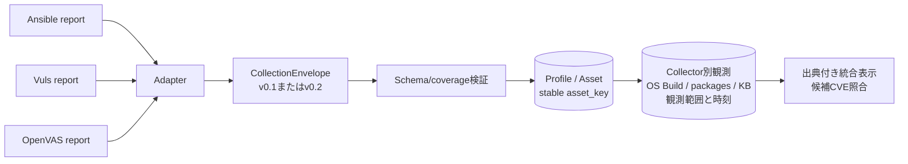

# M1d — 収集データの品質・Collector分離・安定した資産識別

- 対応: [M1d Epic #38](https://github.com/zawa356/vulnfolio/issues/38)、[#39](https://github.com/zawa356/vulnfolio/issues/39)、[#40](https://github.com/zawa356/vulnfolio/issues/40)、[#41](https://github.com/zawa356/vulnfolio/issues/41)
- 状態: **実機接続前のオフラインPoC。合成Linux/Windows/複数Collectorのデータで検証**。実機検証は [#30](https://github.com/zawa356/vulnfolio/issues/30)。
- 正本: この文書と[`inventory_import.py`](../src/vulnfolio/inventory_import.py)、[`observation_store.py`](../src/vulnfolio/observation_store.py)、[v0.2 JSON Schema](../contracts/collection-envelope-0.2.0.schema.json)。**作業の最新進捗はGitHub Issuesが正本**。

## 目的と構成



**目標は「スキャンに成功した」≠「情報が完全・正確だ」**を実装で表現すること。通信や認証に成功しても、ディストリ固有のバックポートやKB累積関係まで証明されるわけではない。

## 1. CollectionEnvelope v0.2.0

v0.1.0は**後方互換で受信可能**。v0.2.0は資産ごとの`coverage`と任意の安定`asset_key`を追加する。両バージョンを並行して受け付ける。

| 項目 | v0.1.0 | v0.2.0 |
| --- | --- | --- |
| `schema_version` | `0.1.0` | `0.2.0` |
| `observed_at` | 任意。日時書式未保証 | **タイムゾーン付きISO8601必須** |
| `observations[].asset_id` | 表示・識別に使うホスト名相当 | 同左（人間向け名称） |
| `observations[].asset_key` | 非対応 | **任意の明示的な安定識別子**。同一Profile内で照合 |
| `observations[].coverage` | 非対応 | **必須**。packages/patchesごとに`complete`/`partial`/`unknown` |
| `observations[].os.build` | 入力されたがDB未保存 | **Collector別観測DBへ保存** |
| `findings` | 非空は受信拒否 | 同左（Finding取込は後続開発） |

v0.2.0例（架空情報のみ）：

```json
{
  "schema_version": "0.2.0",
  "profile_id": "0123456789abcdef0123456789abcdef",
  "collector": {"driver": "ansible", "capabilities": ["asset_inventory", "installed_packages"]},
  "observed_at": "2026-11-20T09:00:00Z",
  "status": "success",
  "observations": [{
    "asset_id": "win-lab-01",
    "asset_key": "machine:example-uuid-01",
    "os": {
      "family": "Windows",
      "distribution": "Windows Server",
      "version": "2022",
      "build": "20348"
    },
    "packages": [{
      "name": "Example Service",
      "version": "1.2.3",
      "epoch": null, "release": null, "arch": null,
      "manager": "windows_registry"
    }],
    "patches": ["KB5000000"],
    "coverage": {"packages": "partial", "patches": "partial"},
    "inventory_scope": "reported",
    "source": "ansible"
  }],
  "findings": [],
  "errors": []
}
```

**CollectionEnvelopeは信頼性を表す契約であり、脆弱性が修正されたか否かの契約ではない。**

## 2. Coverageの意味

| 状態 | 空配列を受け取ったとき | 非空配列を受け取ったとき |
| --- | --- | --- |
| `complete` | **そのCollectorの当該項目だけ**既存データをクリア | **そのCollectorの当該項目だけ**新一覧へ置換 |
| `partial` | 既存データは残す | 既存データを残して観測した項目を追加。欠けているものを削除しない |
| `unknown` | 既存データは残す。今回未検証と明示 | **入力不正として拒否**。未検証なのに項目を含めることは禁止 |

`complete`は信頼できる収集方式と対象環境が**全件列挙を保証する場合だけ**指定する。現在のAnsible収集CLIは機械的に完全性を証明しないため、**v0.2出力を選択しても自動では`complete`を付けない**。Windowsの`Get-HotFix`はWindows Update全件を表さないことに注意。

v0.1の`inventory_scope=reported`からは完全性を推測しない。互換動作として**非空なら同一Collectorの以前の報告を置換し、空なら不明として維持**する。別Collectorは削除しない。

`packages_state`/`patches_state`は**直近試行の状態**、`packages_observed_at`/`patches_observed_at`は**最後に項目を実際に観測できた時刻**。例えば今回の`unknown`によって状態を不明にしても、以前の結果と時刻は参考情報として残す。この古いデータは**現在の資産状態を保証しない**。

## 3. Collectorごとの非破壊保存

- **Profile + Asset + Collector**ごとにSource Observationとインポート由来製品一覧を保持する。
- Ansibleの`complete`再収集は、**Vulsや手動登録のデータを削除しない**。
- Windows KBもCollector別に別保存。`os.build`は同じくソース別で保存。
- 同一Collectorの古い`observed_at`を後からインポートしても、その観測値で最新状態を上書きせず`stale_skipped`件数を返す。
- インポート全体はSQLトランザクション。途中の資産名衝突・不正な書式・複数観測の重複で部分登録しない。
- 異なるCollectorが同じ製品を観測すると、一覧には**出典別**に行が並ぶ（誤った同一視・統合を避ける）。CVE候補一覧は資産×CVEで従来どおり代表行を返すため、これは**候補**に過ぎない。

### 既存DBの移行

起動時に旧`asset_inventory_snapshots`、`imported_products`を読み込み、**一度だけ**新しいテーブルにコピーする。手動製品とAssessment/変更履歴はそのまま残す。旧テーブルは削除しない。

**旧M1bでは異なるCollectorが同じ一覧を上書きしていた可能性があり、元の出典を完全復元できない。** したがって旧インポート情報は`legacy-unverified`（出典未検証）として保存する。新しいCollectorの観測結果で自動消去・「安全」扱いにはしない。PoCで確認後、信頼性を再評価すること。

## 4. Asset IDとStable Key

- URL・DB・Assessmentの内部`asset_id`は従来どおり固定の32文字ID。
- v0.2の`asset_key`は**入力側が明示的に安定性を保証**できるときにのみ指定。例：管理台帳で発番された固有識別子。
- 同一Profile内で同じ`asset_key`を再使用すれば、ホスト表示名が変わっても**同じ内部Asset/Assessmentを維持**する。
- `asset_key`が異なる資産を、同一ホスト名を理由に自動マージしない。名前衝突があればインポートを422で拒否し、利用者による明示的な解決を要求する。
- Stable Keyのないv0.1やv0.2は**従来のホスト名照合へフォールバック**。再利用名・Renameで誤認・重複する可能性があり、実機運用前にKeyの選定が必要。
- Stable Keyを秘密の認証情報・パスワードとして使わない。個体識別情報もインベントリ同様に非公開管理する。

## 5. ローカル収集CLI（実機接続なしでも試せる）

旧v0.1出力は従来どおり**デフォルトで利用可能**。v0.2の明示選択と安定IDのマップは次のとおり。

```bash
# 既存fixtureを使ったローカル変換。ここではリモート機器に接続しない
python -m vulnfolio.collector_export \
  --artifacts ./private-data/host-artifacts \
  --expected-host rhel-demo \
  --profile <profile-id> \
  --schema-version 0.2.0 \
  --asset-key-map ./private-data/asset-keys.json \
  --output ./private-data/m1d-collected.json
```

任意の`asset-keys.json`は`{"rhel-demo":"machine:my-stable-id"}`形式。指定された収集ホストと対応しないキーはエラー。秘密情報や個人情報を記載せず、台帳に合った**安定かつ重複しない識別子**を使う。実ホストから収集する場合は従来の`--inventory`を使うが、**権限ある検証対象だけ**で実施する。

CLIのv0.2出力は非空の項目を`partial`、空項目を`unknown`と保守的に表示する。**自動で完全取得と宣言しない。** 明示的な`complete`の取り込みは、合成fixtureや取得範囲の別途検証ができた場合にのみ使用する。

次に[My Environment](poc-m1.md)へローカル手動インポート、または[期限付きTokenのHTTPS送信PoC](poc-m1c-https.md)からインポートする。両方の経路で同じValidator/Importerを使用する。

## 6. API / UI

既存レスポンスとの互換性を維持する。

- `GET /api/v1/assets/{asset_id}/inventory`: 従来の`snapshot`を継続し、**`sources[]`を追加**。各ソースにOS Build、`packages_state`/`patches_state`、前回成功時刻、KB一覧を付加。
- `GET /api/v1/assets/{asset_id}/products`: `source_collector`/`coverage`/`observed_at`を追加。手動製品は`origin=manual`、外部観測は`origin=imported`。
- WebのMy Environment: OS Build、Collector名、Coverage、日時を出典別に表示。`unknown`はあくまで未確認であり「脆弱性がない」とは表示しない。
- `POST /api/v1/profiles/{id}/imports`と`POST /api/v1/ingest/profiles/{id}/imports`: v0.1/v0.2を受け入れ、新規/重複の応答に`stale_skipped`を追加。

## 7. オフラインテストと残留リスク

```bash
python -m pip install -e .
python -m pip install 'jsonschema>=4.21,<5'  # CI用のみ
python -m unittest discover -s tests -v
node --check src/vulnfolio/web/environment.js

# Chromium/Playwrightを導入している場合
python scripts/m1_browser_smoke.py
```

- Ansible・Vulsの同名ホスト、明示的な完全空観測、部分観測、Unknown、古い観測、改名、別Key衝突、Windows OS Build、KB、既存DBの移行、JSON Schemaを合成データで確認。
- **本番の適用済み/未適用のCVE判定は未実装**。RPMのバックポート、Debian Security Tracker、Windows累積KB、Scanner Finding取込は次の独立イテレーションで扱う。
- `partial`のパッケージ情報は以前の版と新しい版が併存し得る。これを現在インストール中の確定一覧と扱わない。
- 旧データの`legacy-unverified`はユーザー側で整合性確認が必要。正式な削除・エクスポート・データ保管ポリシーは本番公開前の[#33](https://github.com/zawa356/vulnfolio/issues/33)に残る。
- **実機接続/互換性検証は未実施**（[#30](https://github.com/zawa356/vulnfolio/issues/30)）。検証PoCはランブックを読んで権限ある環境で実施する。

関連：[M1b](poc-m1-import.md) / [M1c収集](poc-m1c-agentless.md) / [JSON Schema](../contracts/collection-envelope-0.2.0.schema.json) / [GitHub進捗](https://github.com/zawa356/vulnfolio/issues)
